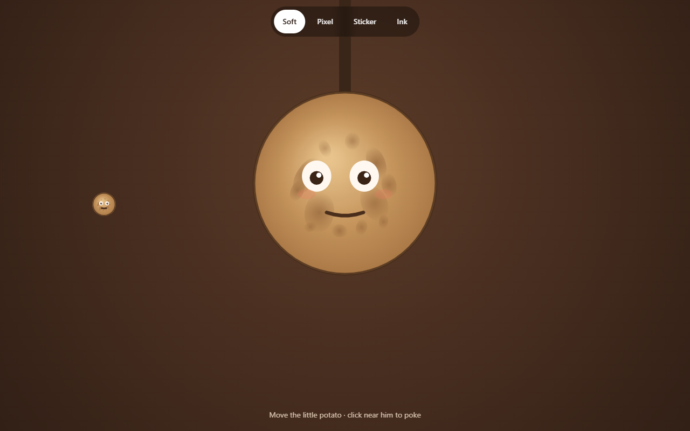
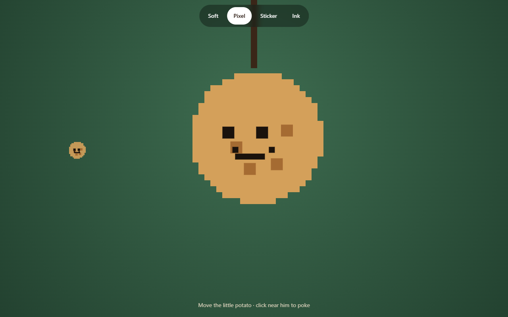
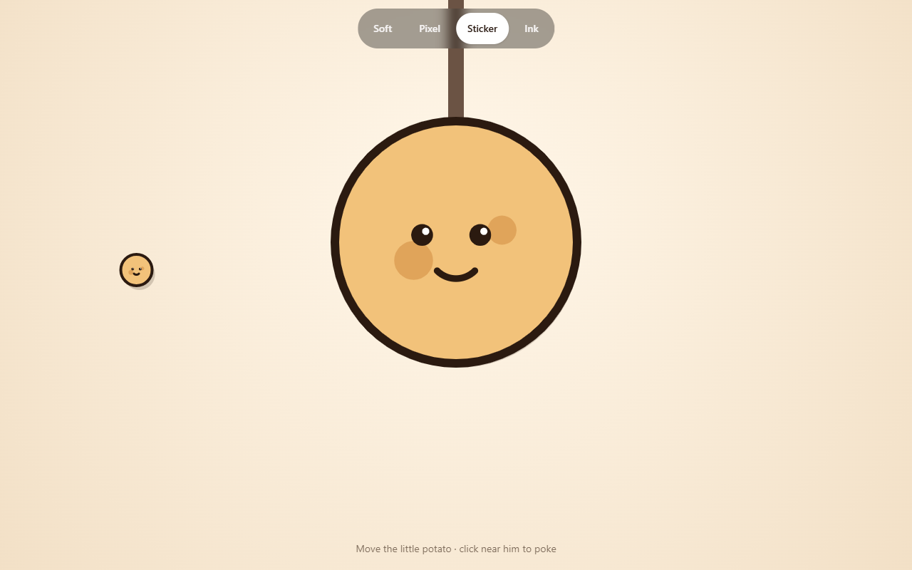
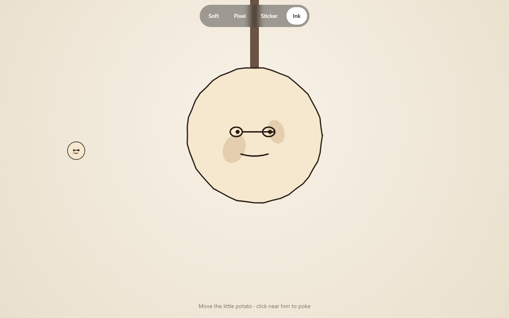

<div align="center">

# Poke the Potato

**A tiny, slightly grumpy canvas toy.**

Move the little potato. Poke the big one. Watch the eyebrows happen.

[](LICENSE)
[](https://react.dev)
[](https://vite.dev)
[](https://tanstack.com/start)

```text
      .-"""-.
     /  . .  \
    |  (o o)  |     <- the big one (do not poke)
     \  \_/  /
      `-----'
         |
         |
        \|/
```

</div>

---



## Once upon a potato

There is a large potato. It hangs from a string and minds its own business.

There is a small potato. It is you, basically.

Move the small one toward the big one, then click (or tap) when you are close. The big one
becomes dramatically upset for a moment, which is the entire point. It calms down. You can do it
again. This is a complete game loop, and we stand by it.

## Four moods, one potato

Every style is drawn on a single `<canvas>` by hand — no sprite sheets, no image loading, no
waiting. Switching moods is instant, and the whole potato is redrawn every frame.

<table>
  <tr>
    <td align="center" width="50%">
      
      <br />
      <b>Soft</b><br />
      Warm, buttery, gently shaded.
    </td>
    <td align="center" width="50%">
      
      <br />
      <b>Pixel</b><br />
      Chunky blocks and quiet nostalgia.
    </td>
  </tr>
  <tr>
    <td align="center" width="50%">
      
      <br />
      <b>Sticker</b><br />
      Thick outlines, zero regrets.
    </td>
    <td align="center" width="50%">
      
      <br />
      <b>Ink</b><br />
      Wobbly lines on warm paper.
    </td>
  </tr>
</table>

## How to play

| You want to…       | Mouse                  | Finger                |
| ------------------ | ---------------------- | --------------------- |
| Move the small one | Move the cursor        | Drag                  |
| Poke the big one   | Click when you're near | Tap when you're close |
| Change the mood    | Tap a style pill       | Tap a style pill      |

The big potato only reacts when the little one is within poking distance. It has boundaries. It
also has a flash, a puff of particles, and a short haptic buzz on supported phones.

## Run it locally

```bash
npm install
npm run dev
```

Open <http://localhost:8080>. The dev server is bound to `0.0.0.0:8080`, so you can also open it
from your phone on the same network.

## Build it

```bash
npm run build
```

The default build targets Vercel through Nitro. For a plain Node server instead:

```bash
NITRO_PRESET=node-server npm run build
node .output/server/index.mjs
```

## Small screens, big feelings

This toy was tuned on a Redmi-class Android phone, because that is where potatoes are poked most:

- Canvas resolution follows `devicePixelRatio` up to **3×**, so the edges stay crisp.
- `visualViewport` and `ResizeObserver` keep the stage sized when the browser bars slide around.
- `env(safe-area-inset-*)` keeps the style pills and the hint out of notches and home bars.
- Style pills are **44px tall** — friendly to thumbs.
- A short vibration on poke, where the browser supports it.
- Particles are capped at **80**, because mid-range phones deserve smooth potatoes too.
- Overscroll, pull-to-refresh, text selection, and double-tap zoom are switched off.

## The potato map

```text
src/
  components/PotatoStage.tsx   the whole toy: four art styles, poke physics, particles
  routes/__root.tsx            document shell, social cards, PWA links
  routes/index.tsx             the stage itself
  lib/error-component.tsx      a graceful "oops" screen
  router.tsx                   TanStack Router setup
  styles.css                   page reset and mobile scroll rules
public/
  manifest.json                installable web app manifest
  icon.png                     the potato in app-icon form
  favicon.svg                  the potato in tiny form
  og.jpg, x-banner.jpg         social preview cards
screenshots/                   the four moods, plus a phone-sized soft potato
```

## Scripts

| Command             | What it does                                |
| ------------------- | ------------------------------------------- |
| `npm run dev`       | Start the dev server on `0.0.0.0:8080`      |
| `npm run build`     | Production build (Vercel preset by default) |
| `npm run preview`   | Preview the production build                |
| `npm run typecheck` | TypeScript, no output                       |
| `npm run lint`      | ESLint                                      |
| `npm run format`    | Prettier                                    |

## License

MIT — see [LICENSE](LICENSE).

<div align="center">

Made with warm brown pixels.<br />
No potatoes were harmed; one was mildly inconvenienced.

</div>
